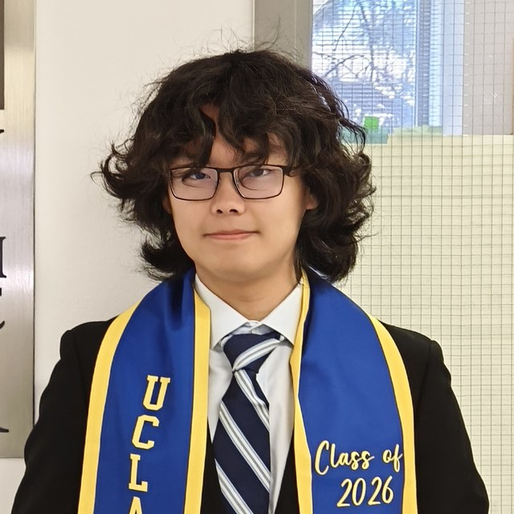

::: {.hero}
 
{.portrait}

## Yiyang (Ian) Chen, B.S. Cognitive Science, UCLA 2026
&nbsp;[CV](files/CV_A06.pdf) · [GitHub](https://github.com/yiyangc22) · [LinkedIn](https://www.linkedin.com/in/ianchen5432953/)&nbsp;&nbsp;ORCID: 0009-0000-0498-0593

Hi! I am a researcher in the [Luo Lab](https://luogenomics.github.io/) and the [Golshani Lab](https://golshanilab.neurology.ucla.edu/) at UCLA's David Geffen School of Medicine, developing methods for spatial single-cell sequencing and voltage imaging in the mammalian brain.

I am interested in combining molecular barcoding and sequencing with tissue and in-vivo imaging to map neuronal connectivity, together with each neuron's epigenomic identity or live firing patterns, at single-cell resolution. You can read more about my work on the [research page](research.qmd).
:::
