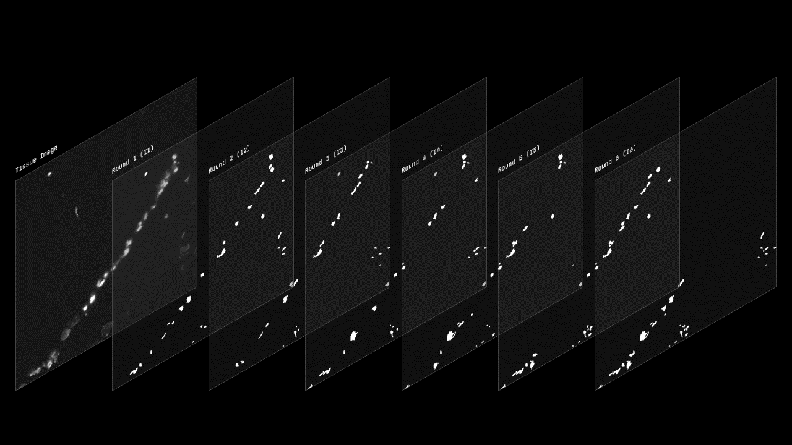
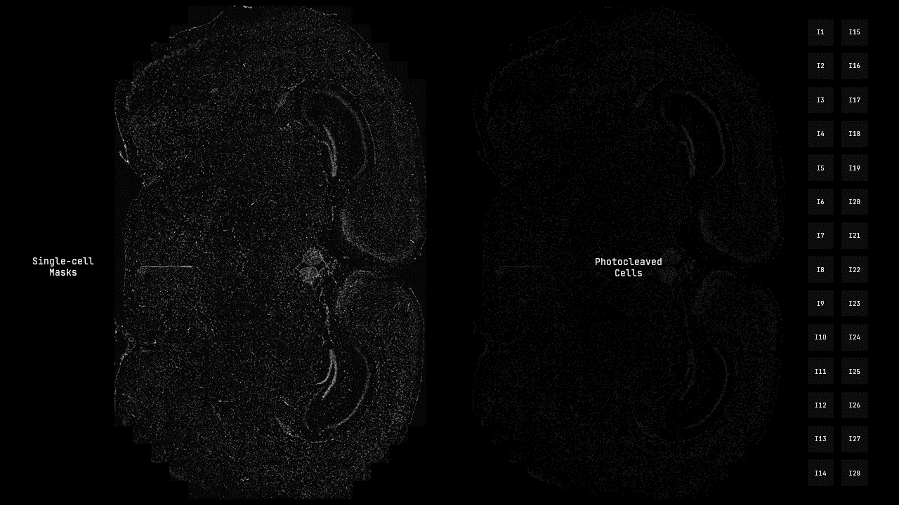
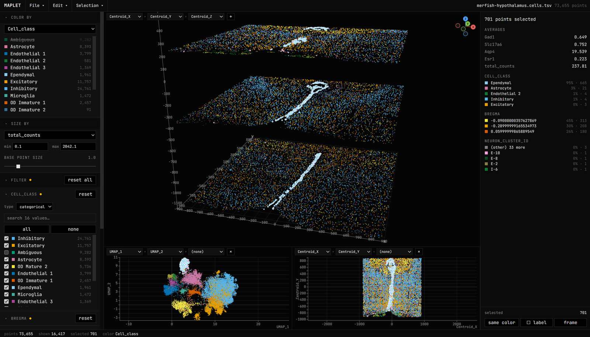

# Research Interest

My goal is to understand how biological mechanisms give rise to cognition. The question I keep returning to is how a neuron's molecular identity relate to its connections, activity patterns, and the role it plays in a circuit, and I am currently narrowing this question toward memory, decision making, and visual perception.

Answering this requires measuring activity, connectivity, and molecular identity in the same neurons. Each can now be measured on its own: imaging records activity in the living brain, electron and expansion microscopy reconstruct wiring, and single-cell sequencing reads identity. But reading identity and wiring requires fixed tissue, so combining them with activity recorded in a living brain remains difficult, and only a few datasets have achieved even two of the three in the same cells. I am interested in adapting and combining existing methods, such as voltage imaging and spatial sequencing, to answer specific biological questions, and eventually in carrying what we learn toward the human brain.

# Luo Lab at UCLA

My interest in the molecular and cellular processes behind cognition led me in late 2023 to the Luo Lab at UCLA, a neuroepigenomics group (epigenomics studies how chemical and structural modifications to chromatin regulate gene expression). There, I help develop photonic-indexing sequencing (pi-seq, also called PSI-seq), a new technology for mapping epigenomically defined cell types in mammalian brain tissue.

## Pi-seq/PSI-seq

Pi-seq uses light to assign DNA barcodes to individual cells according to their location in tissue, producing spatially resolved single-cell profiles of DNA methylation and chromatin conformation that let us study cell-type-specific gene regulation in the brain. For this project, I designed the single-cell spatial barcoding methods, the statistical decoders that recover each cell's barcode from sequencing reads, and the optofluidic microscope that automates spatial encoding.

In a pi-seq experiment, each cell receives a unique combination of DNA barcode segments that encodes its spatial identity, built up over successive rounds of patterned photocleavage and barcode insertion. To give thousands of cells unique barcodes in situ, I developed a combinatorial indexing scheme (the "bit-scheme") that determines which cells are photocleaved in each round, and therefore which barcode segments each cell receives.

<blockquote>Patterned photocleavage builds a unique barcode sequence for each cell</blockquote>


Applied to a whole tissue section, the bit-scheme gives every segmented cell its own sequence of indexing rounds. The bit-scheme design tools are part of Mercury, the software I wrote to run the pi-seq microscope, and are released as an open-source Python package, [Mercury-Redstone](https://github.com/yiyangc22/Mercury-Redstone) (DOI: [10.5281/zenodo.22650611](https://doi.org/10.5281/zenodo.22650611)).

<blockquote>Example bit-scheme on a mouse brain cross-section: single-cell masks (left) and the cells photocleaved in each round (right)</blockquote>


To inspect decoded cells and downstream analyses in their tissue context, I also built [Maplet](https://github.com/yiyangc22/Maplet) (DOI: [10.5281/zenodo.22651477](https://doi.org/10.5281/zenodo.22651477)), a standalone browser app that displays spatial sequencing and analysis results in 3D from plain spreadsheets. It runs [directly in the browser](https://yiyangc22.github.io/Maplet/), with no installation.

<blockquote>Maplet displaying a public MERFISH dataset of the mouse hypothalamus (<a href="https://doi.org/10.1126/science.aau5324">Moffitt et al., 2018</a>)</blockquote>


# Golshani Lab at UCLA

While surveying the developing brain with spatial epigenomic profiling in the Luo Lab, I became interested in linking each cell's molecular identity to what it does in the living brain. To learn the state of the art in recording neuronal activity in vivo, I joined the Golshani Lab in April 2026. The lab uses voltage imaging to study how hippocampal population activity relates to navigation, learning, and memory in mice.

Voltage imaging uses fluorescent indicators of membrane voltage to record sub-threshold membrane potential changes that calcium imaging cannot resolve. Its main challenge, in both one- and two-photon voltage imaging, is a low signal-to-noise ratio (SNR): the indicators are intrinsically dim, the high frame rates needed to capture fast voltage dynamics leave few photons per frame, background fluorescence from surrounding tissue adds noise, and photobleaching limits how long each neuron can be recorded.

My work aims to make these recordings, and what we extract from them, as reliable as possible: I am developing machine vision methods to detect active neurons in voltage imaging recordings, and I have redesigned the lab's high-speed camera acquisition pipeline and built real-time analysis software for behavioral training and imaging sessions.

## Detecting Firing Neurons in Voltage Imaging Recordings

Before a neuron's activity can be measured, the neuron has to be found, and in voltage imaging, a firing neuron's signal in any single frame is often weaker than the camera noise. Many automated pipelines therefore compress the recording into a few summary images and segment neurons on those images instead: VolPy ([Cai et al., 2021](https://doi.org/10.1371/journal.pcbi.1008806)), for example, feeds a mean image and a correlation image into a Mask R-CNN.

In the Golshani Lab's pipeline, this step is still done by hand: after each recording is motion-corrected, an experimenter outlines every firing neuron before its trace, spike times, and SNR are extracted. I am building a tool that replaces only this manual step. It takes the same motion-corrected video as input and returns an outline and a probability heatmap for each active neuron, so its output can go straight into the lab's existing trace extraction. Every approach is developed on a subset of the lab's hand-annotated recordings and scored on a recording it has never seen, since that is how the tool will be used.

```
> motion-corrected video ─┬ ┄ ┄ hand-drawn outlines (current) ┄ ┄ ┬─ trace extraction >
                          │                                       │
                          └─ model detection: outlines + heatmap ─┘
```

**A single network on summary images.** As a benchmark, I first rebuilt the lab's existing approach: compress the video into an average image, which shows each cell's shape, and an activity image, which highlights pixels that flash, then train [Cellpose](https://github.com/MouseLand/cellpose) on both as two input channels. This asks one network to learn, from a small number of hand-drawn neurons, both what a neuron looks like and whether it fires, while the summary images discard when each flash happened.

**Two stages: find every cell, then decide which ones fire.** Because shape and firing are different problems, I split them. In the two-stage design I am now building, the first stage uses Cellpose, fine-tuned on the lab's own images, to identify every cell in the recording, active or not. The second stage returns to the full video and uses a custom (2+1)D video model, which separates spatial and temporal convolutions ([Tran et al., 2018](https://doi.org/10.1109/CVPR.2018.00675)), to decide which of those cells fire. Splitting the problem this way lets each stage learn from the kind of annotation that suits it best.

```
  SINGLE NETWORK                          TWO STAGES
  ┌─────────────────┐                     ┌────────────────────────┐
  │ ch1: average    │   one network ->    │ STAGE 1: find cells    │   every cell,
  │ ch2: activity   │                     │ fine-tuned Cellpose    │   active or not
  │ -> Cellpose     │                     │ -> cell outlines       │
  └─────────────────┘                     └───────────┬────────────┘
                                          ┌───────────┴────────────┐
                                          │ STAGE 2: which fire?   │   custom model on
                                          │ (2+1)D video model     │   the full video
                                          │ spatial, then temporal │
                                          │ -> active neurons      │
                                          └────────────────────────┘
```

## Image Acquisition and Behavior Analysis

Every downstream analysis depends on knowing exactly when each frame was taken. The lab's original acquisition software could not guarantee this: its frame-loss estimate was actually measuring save-to-disk delay, and a silent bug could overwrite unread frames whenever the computer fell behind, producing recordings with the expected number of frames that were not consecutive in time. I rebuilt the acquisition software so that the camera itself counts and timestamps every frame in hardware and every frame is tracked from camera to disk, so that lost or duplicated frames are reported rather than hidden.

In parallel, the lab's behavioral experiments (random-reward, spatial-navigation, and working-memory tasks on a treadmill) were previously analyzed in MATLAB only after each session. I rebuilt the behavior-monitoring software in Python to analyze each session as it runs: it shows the mouse's position, licking, and video live alongside a running lick-probability plot, and generates each task's analysis automatically when the session ends, so experimenters can see how a mouse's behavior changes during training or imaging.
